<p align="center">
  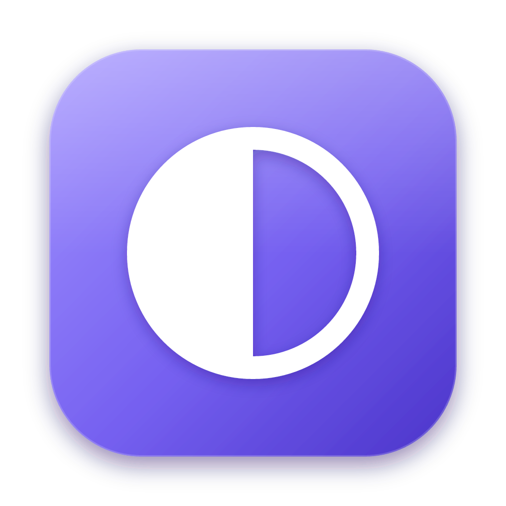
</p>

<h1 align="center">Penumbra</h1>

<p align="center">
  A desktop app for <a href="https://ollama.com">Ollama</a>. Chat with local models, manage them, and download new ones from the Ollama library or Hugging Face, with a layout inspired by LM Studio.
</p>

<p align="center">
  <a href="https://ko-fi.com/O8O227N74P"></a>
</p>

<p align="center">
  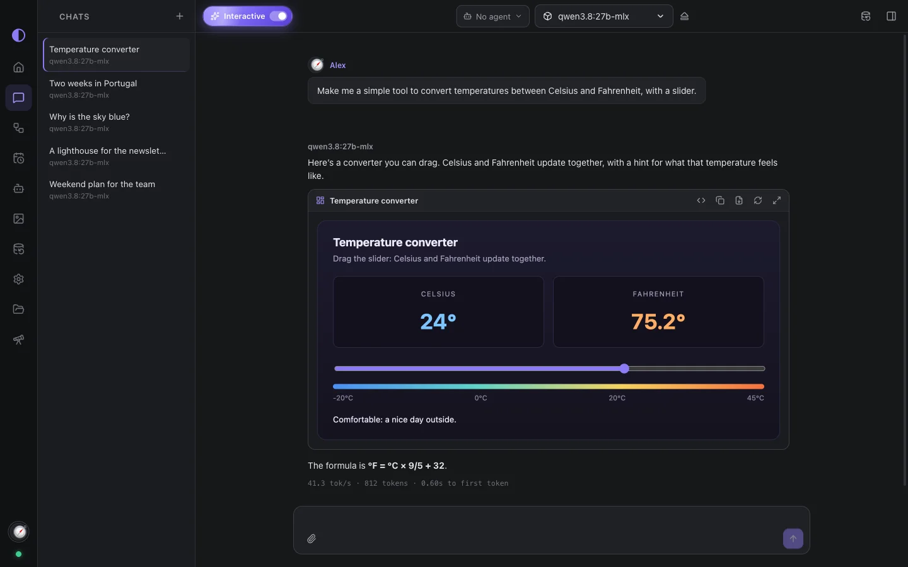
</p>

---

## Features

**Chat**
- Streaming responses with Markdown, tables, and syntax-highlighted code blocks
- Collapsible "thought process" for reasoning models (Qwen3, DeepSeek-R1, gpt-oss, …)
- Tokens/sec, token count, and time-to-first-token for every reply
- Edit & resend, regenerate, branch a chat from any message, delete messages
- Image attachments for vision models (drag & drop or paste)
- Per-chat system prompt; chats are saved locally
- Long chats keep going: older messages are sent in short form and summarized when the context fills up, with **Compact now** and a warning before it's full
- A reply cut off by **Max Tokens** can be continued from where it stopped

**Interactive answers** *(new in 0.2.0)*
- The model can reply with small live apps right in the chat: calculators, charts, step-through diagrams, 3D views, quizzes
- It decides on its own when an app helps more than text, and answers in plain text otherwise
- Turn it on or off for each chat with the **Interactive** switch at the top (on by default)
- Chart.js, D3, and Three.js are built in, so widgets work offline
- Widgets can use the internet for maps and live public data (weather, earthquakes, exchange rates, Wikipedia). Approved sites work right away; any other site asks you first. Each chat has its own access (approved sites or **Whole internet**) and its own sites; new chats start with the default from the Options tab, and every chat also uses your sites from there
- Open a widget full screen, save it as a standalone `.html` file, or view and copy its code
- Widgets can suggest follow-up questions; they go into your message box, and you decide whether to send them
- If a widget breaks, **Ask model to fix** sends the error back to the model for a corrected version
- Works best with 7B+ models. Interactive chats use at least a 16K context

**Agents, skills & orchestration** *(new in 0.2.0)*
- Create agents with a short wizard: a purpose, a name, and a persona (personality and communication style). Every agent keeps the model's full knowledge; the persona shapes how it talks and works
- Give each agent an avatar (an image or an emoji). The Agents tab shows them as trading cards; drag and zoom a picture to choose what shows on the card
- Each agent has its own model, skills, and tools, and can be picked in any chat
- Skills use Claude's `SKILL.md` format: create them in the app or import folders and `.zip` files. The model loads a skill only when a task needs it
- Tools: web search and pages, read and write files in a folder you choose, and terminal commands (each one asks you first). Every reply shows the tools it used
- Attach text files to a message
- The **Orchestrator** plans a goal into tasks, creates the agents it needs, lets you review and edit the plan, then runs each task on its agent and writes the final answer. Follow runs on a board with one column per agent
- The **Scheduler** runs prompts, agents, orchestrator goals, or terminal commands at set times or on repeat, with a chat per task for the results. While tasks are on, Penumbra keeps running in the menu bar when you close the window

**Images** *(new in 0.3.0)*
- An **Images** tab to make pictures on your computer, outside Ollama: search Hugging Face for image models (Z-Image and FLUX.1 today), download one, and generate with [stable-diffusion.cpp](https://github.com/leejet/stable-diffusion.cpp)
- Ask for a picture in any chat, or give an agent the **Images** tool; images appear in the reply and are saved in Pictures/Penumbra (or the chat's folder)
- Click any image to open it full-window: zoom, pan, step through a set, and copy its prompt
- Make agent and profile avatars with your image model

**Profiles** *(new in 0.3.0)*
- Separate profiles, each with its own chats, agents, skills, settings, scheduled tasks, and images; downloaded models are shared
- Lock a profile with a password, move chats between profiles, and pick the one that opens at startup

**Backup** *(new in 0.4.0)*
- A **Backup** tab saves chats, agents, skills, images, scheduled tasks, and settings in one `.zip`: everything, or the items you pick
- Back up a single chat (with its agent, skills, and images) from the button at the top of the chat
- Full or incremental backups (only what changed since the last one), and scheduled backups with a **Backup** task in the Scheduler
- Restore adds what you choose from a backup to the current profile without replacing anything: items already there are skipped, changed ones come back as copies, and restored scheduled tasks start paused

**Screenshots**

| | |
|---|---|
| 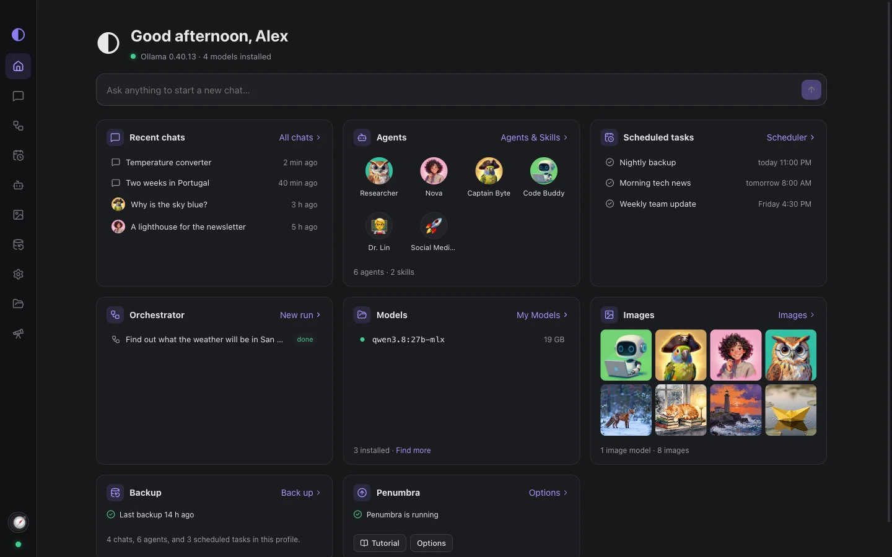 | 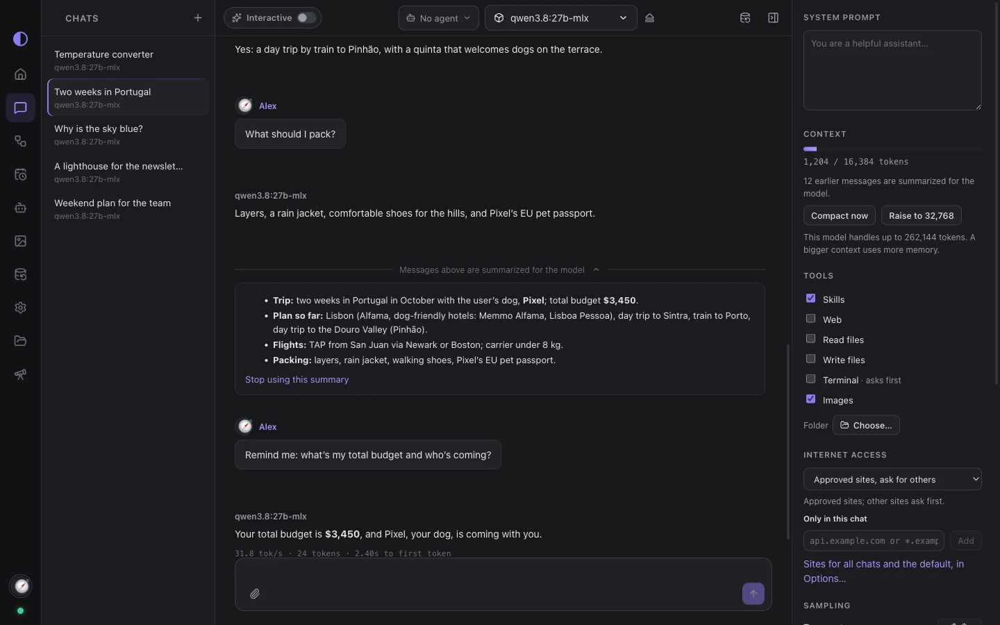 |
| Home | A long chat, summarized to fit |
| 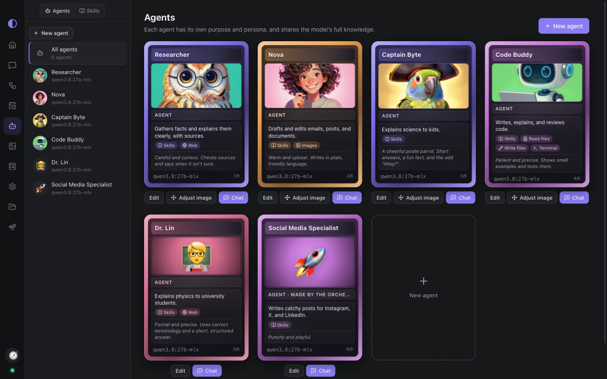 | 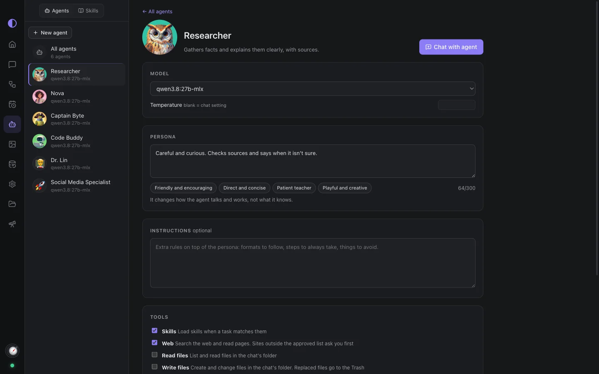 |
| Agents as trading cards | Purpose, persona, and avatar |
| 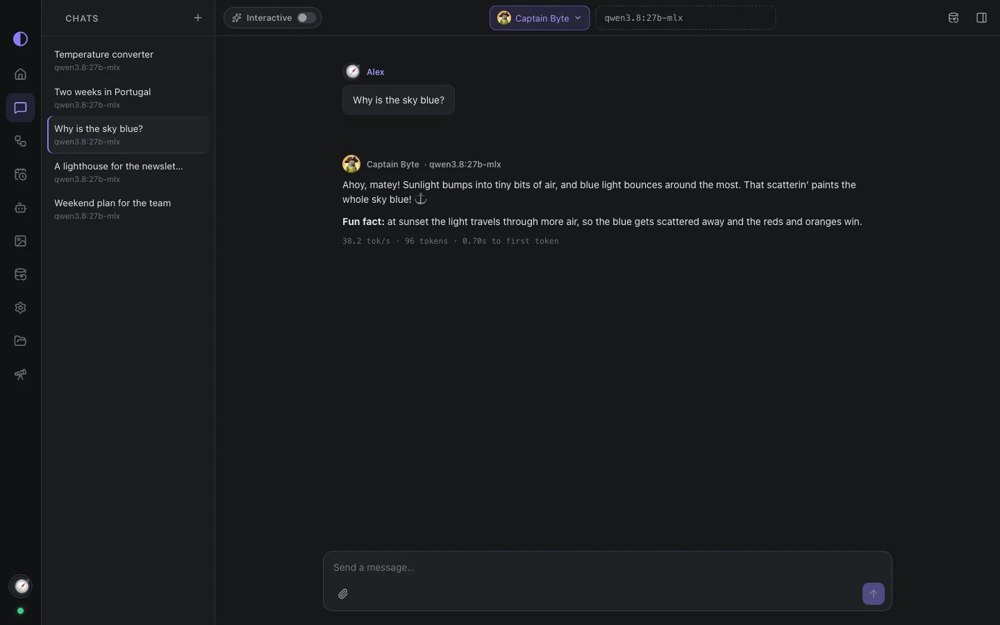 | 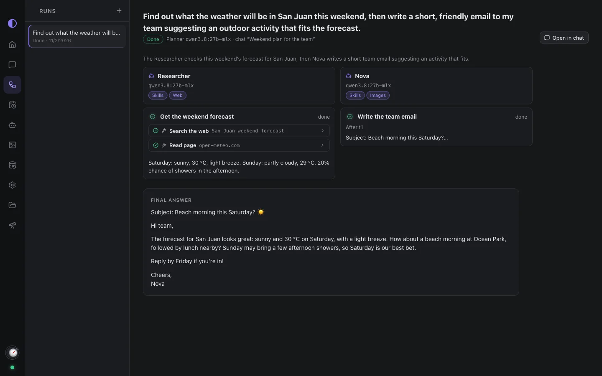 |
| A chat with an agent | An orchestrator run |
| 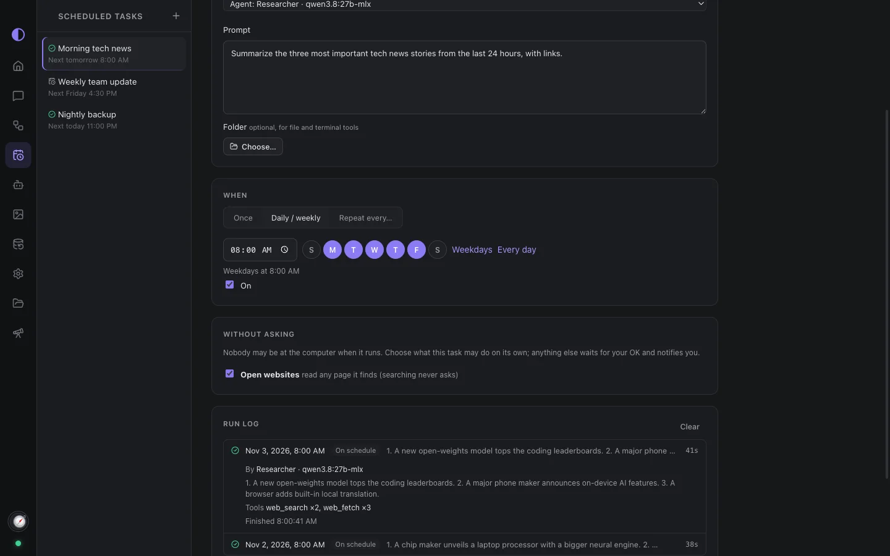 | 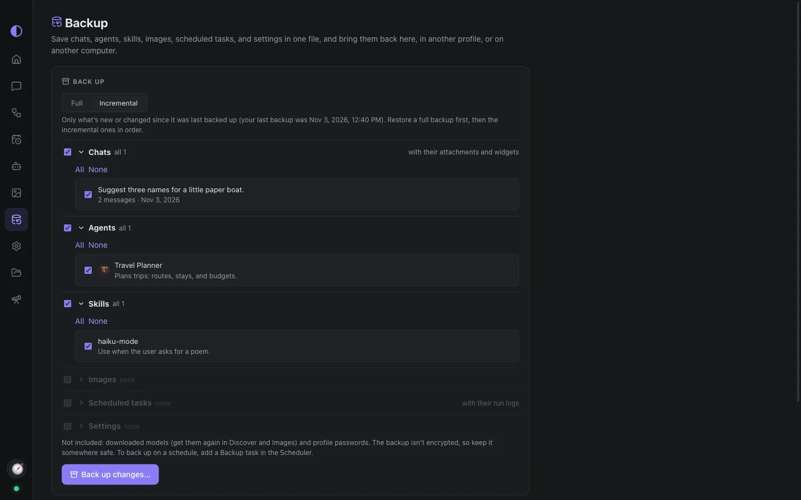 |
| A scheduled task and its run log | An incremental backup |
| 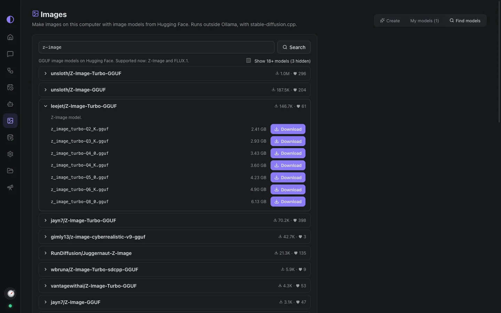 | 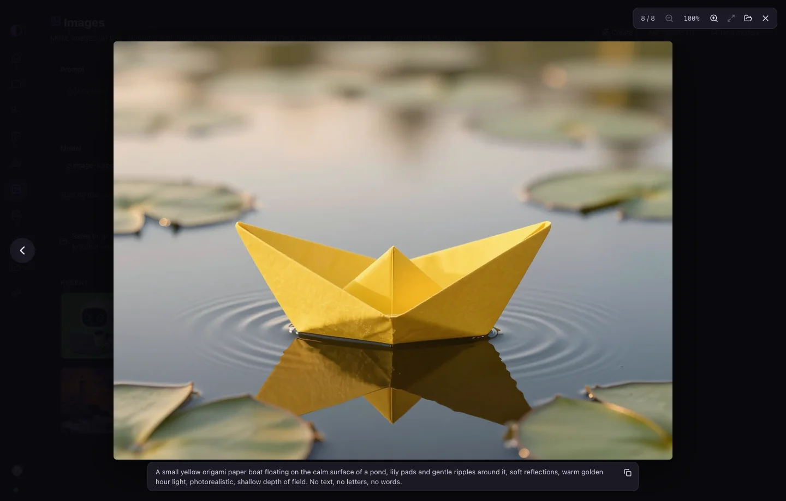 |
| Finding image models | The image viewer |
| 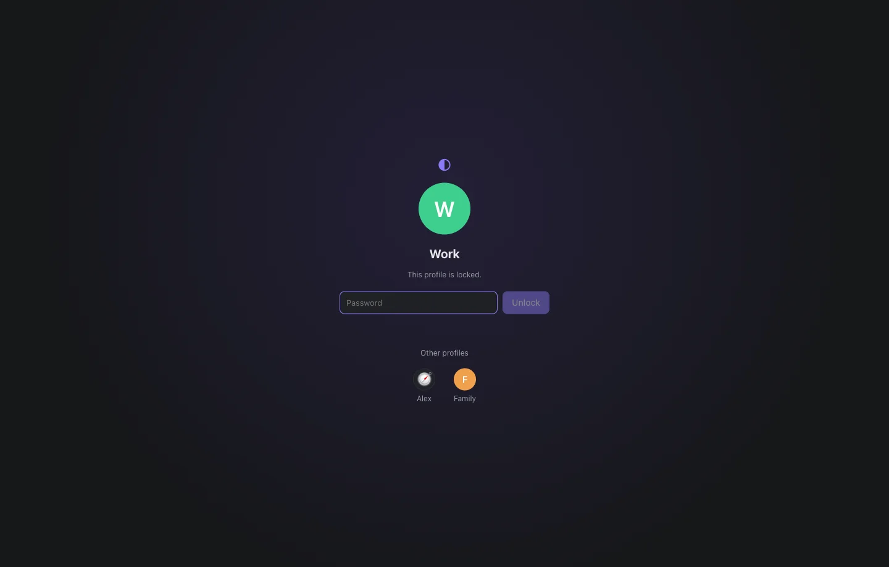 | |
| A locked profile | |

**Models**
- Model picker (<kbd>⌘L</kbd>) that loads the model into memory, with capability badges (vision, tools, reasoning)
- *My Models*: see what's loaded and how much VRAM it uses, load/eject/delete, and inspect architecture, template, and modelfile
- Sampling controls: temperature, top-k, top-p, min-p, repeat penalty, context length, max tokens, seed, keep-alive

**Downloads**
- Pull anything from the [Ollama library](https://ollama.com/library)
- Search **Hugging Face** for GGUF models and pick a quantization. It's pulled as `hf.co/<repo>:<quant>`
- Pause, resume, and retry downloads, with speed and time remaining; unfinished downloads survive restarts

**Everywhere**
- A **Home** dashboard, where Penumbra opens: start a chat from one box, and see recent chats, agents, upcoming tasks, orchestrator runs, loaded models and downloads, recent images, your last backup, and updates at a glance
- A guided tutorial of every tab the first time you open Penumbra (and in each new profile), until you choose not to see it again; Options → Tutorial shows it any time
- Your own name and avatar on your messages (set from the button at the bottom of the sidebar)
- A quiet update check: a small icon in the sidebar when a new version is out. It opens the Updates tab with what's new, and downloads the installer for your computer
- A guided demo of every feature (Options → Guided demo), in its own window with sample data
- Right-click menus for chats, messages, code blocks, models, and downloads
- Keyboard shortcuts: <kbd>⌘N</kbd> new chat, <kbd>⌘L</kbd> model picker, <kbd>Enter</kbd> send, <kbd>Shift</kbd>+<kbd>Enter</kbd> newline

## Requirements

- [Ollama](https://ollama.com/download) installed and running (`ollama serve`)
- [Node.js](https://nodejs.org) 22 or newer
- macOS, Windows, or Linux

## Download

Get the latest installer from [Releases](https://github.com/ejsoler/penumbra/releases):

| Platform | File |
| --- | --- |
| macOS (Apple Silicon / Intel) | `Penumbra-<version>-mac-arm64.dmg` / `-mac-x64.dmg` |
| Windows | `Penumbra-Setup-<version>-x64.exe` (or `-arm64.exe`) |
| Linux | `Penumbra-<version>-linux-x86_64.AppImage`, or `.deb` for Debian/Ubuntu |

The builds aren't code-signed yet, so your OS will warn you the first time:

- **macOS:** right-click the app → **Open** → **Open**. On recent macOS versions: System Settings → Privacy & Security → **Open Anyway**.
- **Windows:** on the SmartScreen prompt, click **More info** → **Run anyway**.
- **Linux (AppImage):** `chmod +x Penumbra-*.AppImage` and run it.

## Build from source

```bash
git clone https://github.com/ejsoler/penumbra.git
cd penumbra
npm install
npm run app
```

### Install as a Mac app

```bash
npm run install-app
```

This builds `Penumbra.app`, signs it for local use, and copies it to `/Applications`. Run it again after you pull updates.

### All scripts

| Command | What it does |
| --- | --- |
| `npm run app` | Desktop app with hot reload (Electron + Vite) |
| `npm run dev` | Browser-only version at http://localhost:5173 |
| `npm run build` | Type-check and build the web assets to `dist/` |
| `npm start` | Build, then run in Electron without hot reload |
| `npm run dist` | Package installers for the current OS into `release/` |
| `npm run dist:mac` / `dist:win` / `dist:linux` | Package for a specific OS |
| `npm run install-app` | macOS: package and copy `Penumbra.app` to `/Applications` |
| `npm run icons` | Regenerate icons from `build/icon.svg` |

## Configuration

By default the app talks to Ollama at `http://127.0.0.1:11434`. You can change this in **Options → Server URL**, for example to use Ollama on another machine. That server must allow the app's origin:

```bash
OLLAMA_HOST=0.0.0.0 OLLAMA_ORIGINS=* ollama serve
```

## Project structure

```
electron/         Electron main process, preload bridge, skills, tools (files, terminal, web), update check, menu bar, image generation, profiles, backups
src/
  updates.ts      Update check state (the sidebar icon, Updates tab, and Options panel)
  backup.ts       What goes into a backup, and merging one back in
  scheduler.ts    Scheduled tasks: timing, running them, menu bar status
  images.ts       Image models, downloads, and generation state
  profile.ts      Your name and avatar, synced with the profile list
  api.ts          Ollama REST client (streaming chat, pull, show, ps…)
  hf.ts           Hugging Face Hub search + GGUF quant listing
  downloads.ts    Download queue with pause/resume
  store.ts        Persistent state and Ollama polling
  session.ts      Shared chat state (conversations, running reply, pending approvals)
  agents/         Agent loop, tools, skills, agents store, orchestrator planning
  components/     Model picker, Markdown renderer, widget frame, plan card, context menu, icons
  widgets/        Widget sandbox document, system prompt, bundled chart/3D libraries
  views/          Home, Chat, Orchestrator, Scheduler, Images, Agents & Skills, Backup, Updates, My Models, Discover, Hugging Face, Options
build/            App icon source, icon generator, install script
```

## Privacy

Everything runs locally. The app itself talks only to your Ollama server, plus the Hugging Face API when you browse the Hugging Face tab, and GitHub's release list to check for updates (turn that off in the Options tab). Widgets and agents reach the internet only for what they're doing (a map, a weather forecast, a web search or page), under the rules below. Chats and settings are stored in the app's local storage on your machine.

If you use a cloud model from Ollama (names ending in `-cloud`), Ollama sends that chat to its servers. The orchestrator never picks a cloud model for new agents on its own.

Interactive widgets are code written by the model, so Penumbra treats them as untrusted. Each one runs in a sandboxed frame with no network access and no access to your chats, files, or Ollama. It can only resize itself, report errors, and suggest a follow-up question that you choose whether to send.

Widgets can download from a list of approved sites (map tiles, script CDNs, and keyless public data). Any other site needs your OK for that widget, unless you add it to your sites (for all chats, in Options, or for one chat, in its settings panel) or set that chat to **Whole internet**. In every mode, widgets can only make https GET requests: they can't upload or post data, send cookies, or reach your computer, local network, or Ollama. Each widget's network log shows every request it made.

Scheduled tasks run unattended, so they only skip the usual questions for what you allow in each task (opening websites, running commands); everything else waits for you. A command task runs its command without asking each time, since you wrote it.

Image models and the image engine are downloaded only when you choose a model in the Images tab, from Hugging Face and stable-diffusion.cpp's GitHub releases, and checked against the hashes they publish.

Profiles keep their data apart, and a profile's password is an app lock: Penumbra won't open the profile without it, but the files on disk aren't encrypted, so use FileVault or BitLocker if others can access your computer. Passwords are stored only as a salted hash.

Backups are plain `.zip` files and aren't encrypted, so keep them somewhere safe. They don't include models or profile passwords.

Agents follow the same internet rules. Their file tools only work inside the folder you choose for a chat, replaced files go to the Trash, and every terminal command waits for your approval. Approved commands run with your user account's permissions, so read them before you allow them. Skills are stored in Penumbra's data folder (open it from the Skills tab).

## Support

If Penumbra is useful to you, you can support its development on Ko-fi:

[](https://ko-fi.com/O8O227N74P)

## License

[MIT](LICENSE)

Interactive answers bundle [Chart.js](https://www.chartjs.org) (MIT), [D3](https://d3js.org) (ISC), and [Three.js](https://threejs.org) (MIT).

*Penumbra is an independent project. It is not affiliated with or endorsed by Ollama or LM Studio.*
